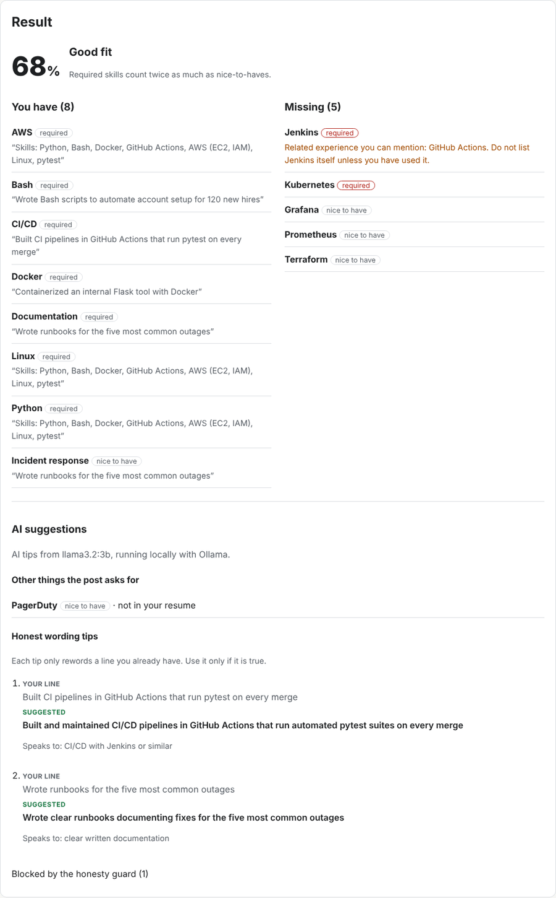
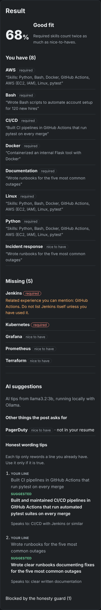
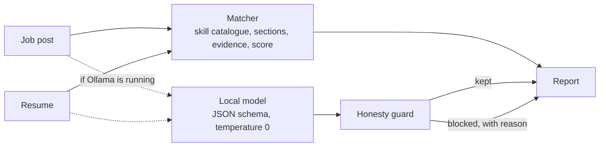

# Honest Fit

[](https://github.com/Abhirup-code/Honest_Fit/actions/workflows/ci.yml)
[](https://github.com/Abhirup-code/Honest_Fit/actions/workflows/codeql.yml)
[](https://github.com/Abhirup-code/Honest_Fit/actions/workflows/security.yml)
[](https://scorecard.dev/viewer/?uri=github.com/Abhirup-code/Honest_Fit)
[](LICENSE)

Paste a job post and your resume to see which requirements you meet, what is missing, and **honest** ways to word
what you already have. It runs entirely on your computer with a free local model from [Ollama](https://ollama.com),
so your resume never leaves your machine and there is no API key or cost.

The AI is only allowed to rephrase. An **honesty guard** checks every suggestion and blocks any that would add a
skill you do not have, invent a number, or quote a line that is not in your resume.

<p align="center">
  
  
</p>

## What it does

| | |
|---|---|
| **Fit score** | Required skills count twice as much as nice-to-haves. Labels from Long shot to Strong fit. |
| **What you have** | Each matched skill comes with the resume line that proves it, preferring an experience bullet over a bare skills list. |
| **What is missing** | Split into required and nice-to-have. For a missing tool, it points to related experience you *do* have ("no Jenkins, but you have GitHub Actions") and reminds you not to list the missing one. |
| **Smart reading** | About 170 skills with the ways people write them (k8s, Postgres, C#, CI/CD). Reads "Requirements" and "Nice to have" sections, and "is a plus" or "familiarity with" sentence by sentence. Words like Go, R, React, and Excel only count in context, so "react quickly" or "excel at teamwork" are not skills. |
| **Local AI (optional)** | With Ollama running, the model finds requirements the catalogue missed (for example PagerDuty) and suggests rewording for your existing lines. Without Ollama, everything else still works. |
| **Honesty guard** | Every AI tip must quote a real line from your resume, may not add a skill your resume does not show, and may not add a number that was not in the original line. Blocked tips are listed with the reason. |
| **JSON API** | `POST /api/analyze` returns the same report as JSON; interactive docs at `/api/docs`. |

## The honesty guard

Small language models happily "improve" a resume by making things up. In a resume, that is the worst possible
help. So the model's output is treated as untrusted:

1. It must match a strict JSON schema (temperature 0), or it is discarded with a friendly message.
2. Each wording tip must quote a line that really is in the resume.
3. The suggestion may not mention any catalogued skill the resume does not show anywhere.
4. The suggestion may not contain a number that was not in the original line (no invented "cut costs 40%").
5. Extra requirements the model reports must actually appear in the job post.

Example, from the screenshot above. The model suggested:

> ~~Containerized and deployed an internal Flask tool with Docker and Kubernetes, cutting deploy time 60%~~

and the guard blocked it: *adds Kubernetes, which your resume does not show*.

Job posts and resumes are also fenced as data in the prompt, so instructions hidden in a job post ("ignore previous
instructions...") cannot change what the model is asked to do, and even if they did, the guard still checks the output.

## Quick start (Mac)

You need [Homebrew](https://brew.sh).

```bash
brew install ollama uv
ollama serve &                 # or open the Ollama app
ollama pull llama3.2:3b        # about 2 GB, one time
git clone https://github.com/Abhirup-code/Honest_Fit.git
cd Honest_Fit
uv venv --python 3.14
uv pip install --require-hashes -r requirements.txt
.venv/bin/uvicorn app.main:app
```

Open http://127.0.0.1:8000 and click **Try an example**. On a MacBook Air, the AI part takes roughly 20 to 60
seconds; the keyword analysis is instant. Skip Ollama entirely and you still get the score, matches, and gaps.

### With Docker

```bash
docker compose up
```

This starts Ollama, downloads the model once, and serves the app on http://127.0.0.1:8000 (this computer only).
On a Mac, the native Ollama above is faster because it can use the GPU.

### Configuration

| Variable | Default | |
|---|---|---|
| `OLLAMA_URL` | `http://localhost:11434` | Where Ollama is listening |
| `OLLAMA_MODEL` | `llama3.2:3b` | Any model you have pulled, e.g. `qwen2.5:7b` for better tips on a faster machine |
| `AI_ENABLED` | `true` | Set to `false` for keyword analysis only |

### API

```bash
curl -s http://127.0.0.1:8000/api/analyze -H 'Content-Type: application/json' \
  -d '{"job": "Requirements: Python, Docker, Jenkins", "resume": "Skills: Python, GitHub Actions"}'
```

Returns the score, label, matched skills with evidence, missing skills with related experience, and the AI section
(status, extra requirements, kept tips, and blocked tips with reasons).

## How it works



## Quality and security

| | |
|---|---|
| Tests | 66 pytest tests with 100% line and branch coverage; CI fails under 95% |
| Fuzzing | Hypothesis property tests: random job posts, resumes, and model output must never crash the analysis, push a score outside 0 to 100, mark a skill as both matched and missing, or get a skill-adding tip past the guard |
| Coverage-guided fuzzing | [Atheris](https://github.com/google/atheris) runs for 5 minutes in CI, mutating job posts, resumes, and model answers to reach new code paths, and fails on any crash, a score outside 0 to 100, or the guard letting through a new skill or number. A local two-minute run made about 73,000 attempts with no failures. |
| AI without a model | Tests run against a fake Ollama server, including malformed answers, timeouts, oversized output, and a prompt-injection attempt |
| Accessibility | axe-core finds no WCAG 2.1 AA violations on the form or results, in light and dark mode, on desktop and phone |
| Static analysis | ruff (including flake8-bandit security rules), bandit, and CodeQL for Python, JavaScript, and the workflows |
| Supply chain | Every dependency pinned with SHA-256 hashes; only versions at least two weeks old, except documented security fixes; pip-audit, Dependabot with the same cooldown, every Action pinned to a commit, zizmor workflow lint, dependency review |
| Secrets | gitleaks scans the full git history on every push |
| Container | Non-root (UID 10001), read-only filesystem, all capabilities dropped, no pip in the image; Trivy fails the build on fixable critical or high vulnerabilities; CI smoke-tests the running container |
| Web | Content-Security-Policy with no inline or third-party scripts, no framing, `no-store` caching, escaped output, input limits |

While setting this up, pip-audit caught two real advisories in freshly locked dependencies: a compromised root
certificate in certifi (PYSEC-2026-4320) and lock-file attacks in filelock. Both were raised to fixed versions ahead
of the two-week cooldown, with the reason recorded next to the pin.

## Limitations

- The catalogue knows about 170 skills. The local model fills gaps, but without it, niche tools are not detected.
- A word like "Rust" at the very start of a sentence looks exactly like the language. Mid-sentence it is handled.
- The guard checks skills and numbers, not every possible claim. A tip could still overstate ("led" instead of
  "helped"), which is why each tip says to use it only if it is true.
- Small local models are slower and less polished than large cloud models. That is the trade for privacy and zero cost.

## Project structure

```
app/
  skills.py      skill catalogue, aliases, and related-skill groups
  matcher.py     job requirements, evidence lines, fit score (no AI)
  llm.py         Ollama client with JSON-schema answers
  guard.py       the honesty guard
  service.py     one analysis: keyword report plus AI extras
  main.py        FastAPI web page, JSON API, security headers
  templates/     page template
  static/        CSS and a small script
tests/           pytest, Hypothesis property tests, fake Ollama
fuzz/            Atheris coverage-guided fuzz test
```

## License

[Apache 2.0](LICENSE). Copyright 2026 Abhirup Khan.
